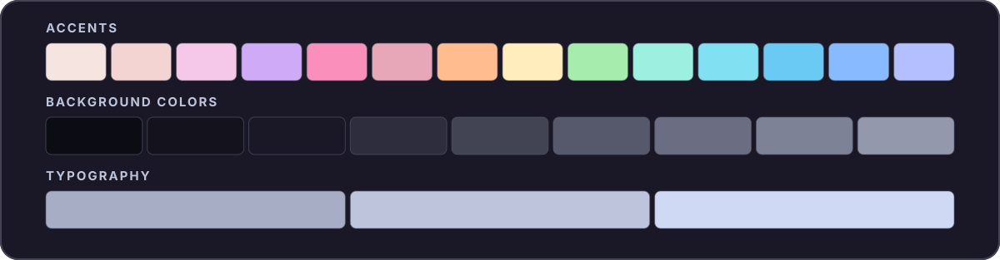

<div align="center">

# ☕ Bicerin

**bee-cheh-REEN**

An unofficial, extra-dark [Catppuccin](https://catppuccin.com/)-inspired color palette.



</div>

## Palette

### Accents

| Color | Hex | Color | Hex |
| :-- | :-- | :-- | :-- |
| Rosewater | `#f6e4e1` | Yellow | `#ffedbe` |
| Flamingo | `#f4d3d3` | Green | `#a6ecad` |
| Pink | `#f5c7e8` | Teal | `#9defe0` |
| Mauve | `#cfaaf7` | Sky | `#81e0f2` |
| Red | `#f98fba` | Sapphire | `#6acaf4` |
| Maroon | `#e8a7b8` | Blue | `#88baff` |
| Peach | `#ffbd8f` | Lavender | `#b3bfff` |

### Background Colors

| Color | Hex | Color | Hex |
| :-- | :-- | :-- | :-- |
| Crust | `#0c0c14` | Mantle | `#14121d` |
| Base | `#1a1826` | Surface 0 | `#2d2d3d` |
| Surface 1 | `#424353` | Surface 2 | `#56586b` |
| Overlay 0 | `#6b6e82` | Overlay 1 | `#7e8297` |
| Overlay 2 | `#9398ad` | | |

### Typography

| Color | Hex |
| :-- | :-- |
| Text | `#d0d9f3` |
| Subtext 1 | `#bdc4db` |
| Subtext 0 | `#a7adc5` |

## Files

| File | Format |
| :-- | :-- |
| [`bicerin.json`](bicerin.json) | Named hex colors |
| [`bicerin.css`](bicerin.css) | CSS custom properties (`--ctp-bicerin-*`) |
| [`whiskers-overrides.json`](whiskers-overrides.json) | Optional Whiskers color overrides |

### CSS

Load [`bicerin.css`](bicerin.css) and reference the variables:

```css
@import url("./bicerin.css");

body {
  background: var(--ctp-bicerin-base);
  color: var(--ctp-bicerin-text);
}

a {
  color: var(--ctp-bicerin-blue);
}
```

<details>
<summary>Whiskers</summary>

Render a [Whiskers](https://whiskers.catppuccin.com/concepts/overrides/) template with Bicerin colors and flavor names:

```sh
sed -E \
  -e 's/\{\{[[:space:]]*flavor\.identifier[[:space:]]*\}\}/bicerin/g' \
  -e 's/\{\{[[:space:]]*flavor\.name[[:space:]]*\}\}/Bicerin/g' \
  template.tera | whiskers - -f mocha --color-overrides whiskers-overrides.json
```

</details>

## License

[MIT](LICENSE). Bicerin is an independent project, not affiliated with or endorsed by Catppuccin.
